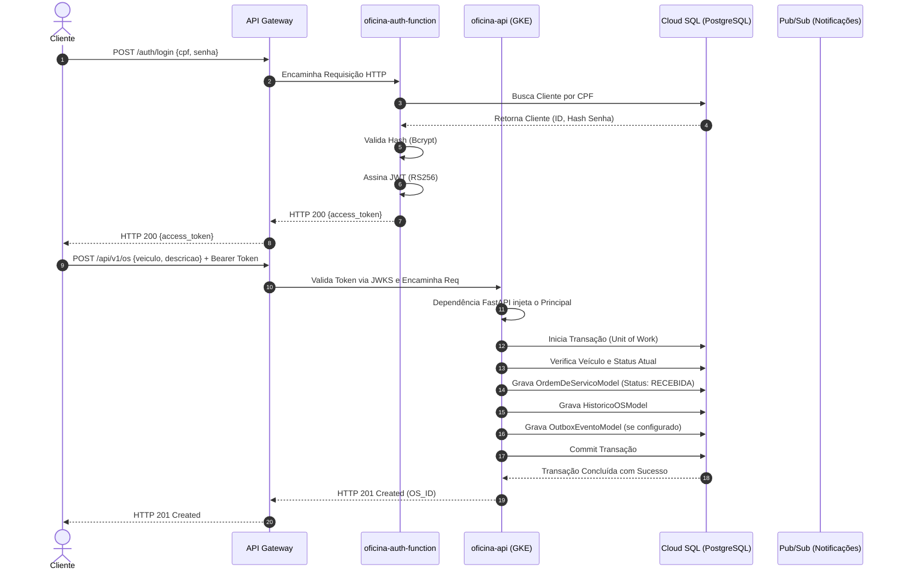

# Diagrama de Sequência

> Registro histórico anterior à divisão em microsserviços da Fase 4. Não representa a topologia atual de homologação. Consulte os ADRs [014](../adr/ADR-014-divisao-microsservicos-fase4.md), [015](../adr/ADR-015-bancos-por-servico-sql-nosql.md) e [016](../adr/ADR-016-saga-orquestrada-e-compensacoes.md) para os limites e bancos atuais.

Abaixo detalhamos o fluxo arquitetônico e de negócio para **Autenticação de Cliente** seguido da **Abertura de uma Ordem de Serviço**.

